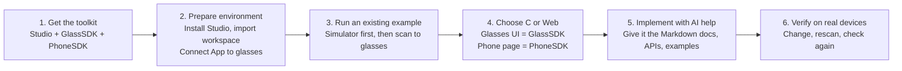

# Getting Started with MemoMind Plugin Development

A condensed, checked guide based on the official MemoMind Open Platform docs (read 2026-11-01):

- [Get started](https://open-platform.memo-mind.com/docs/get-started/index/)
- [Toolkit and directory tour](https://open-platform.memo-mind.com/docs/get-started/quickstart/repository-tour/?lang=en)
- [Hardware setup / prerequisites](https://open-platform.memo-mind.com/docs/get-started/quickstart/hardware/?lang=en)
- [Run existing examples](https://open-platform.memo-mind.com/docs/get-started/quickstart/try-examples/?lang=en)

For API details see [`sdk/SDK_OVERVIEW.md`](sdk/SDK_OVERVIEW.md); for ideas see
[`research/IDEAS_AND_ROADMAP.md`](research/IDEAS_AND_ROADMAP.md).

---

## The official route (6 steps)



Official advice: run prebuilt examples first; only set up the compiler once you start editing source.

---

## 1. Get the toolkit

```sh
git clone https://github.com/memomind-open/plugin-open-platform
```

Or download the repo as a ZIP and extract the whole archive. The **toolkit root** is the folder
that contains `GlassSDK/`, `PhoneSDK/`, `Studio/` and `build.py` together. Keep all three
directories together and **don't delete dot-directories**: `GlassSDK/build-host/.build/` holds the
prebuilt example `.gmp` files and their review sidecars.

| Path | What it is |
| --- | --- |
| `Studio/windows/gm-plugin-studio-desktop.exe` | Windows 10/11 x64 Studio (needs Edge WebView2 Runtime) |
| `Studio/macos/MemoMind Plugin Studio_0.1.0_universal.dmg` | macOS Studio, Intel + Apple silicon |
| `Studio/linux/` | Placeholder only in the current public release. The docs say to "obtain a release that includes the Linux executable" |
| `GlassSDK/include/gm_plugin.h` | Hardware API entry point (C). `gm_plugin_lvgl_api.h` for UI |
| `GlassSDK/examples/` | C examples (breakout, 2048, lvgl_ui, framebuffer, web_bridge, …) |
| `GlassSDK/build-host/.build/<name>/<name>.gmp` | Compiled plugin + `.review.json` + `.review-source.enc` sidecars |
| `PhoneSDK/examples/` | Web plugin examples (manifest.json + HTML/JS/CSS) |
| `PhoneSDK/dist/*.mmpkg` | Built Web plugin packages |
| `PhoneSDK/packages/web-sdk/` | JS SDK: `createGMPlugin()` and `gm.*` |
| `PhoneSDK/packages/bridge-contract/` | Bridge methods, events, permissions, error contracts |
| `build.py` | Unified build: `./build.py`, `./build.py glass`, `./build.py web`, `--watch`, `--help` |

## 2. Prerequisites checklist

| Item | Requirement |
| --- | --- |
| **Computer** | Windows 10/11 x64 (EXE + WebView2) or macOS (Universal DMG). Linux x64 only with an actual released executable (not in the public repo today). |
| **Phone** | MemoMind App *matching the toolkit*, signed in with the **developer account that owns the application**. Find **Settings → Memo Lab → Developer Workspace**. The QR scanner works on Android and iOS. |
| **Glasses** | Charged, temples unfolded, worn, powered on, and connected **through the MemoMind App** (pairing in system Bluetooth alone isn't enough). Firmware must support the current SDK ABI. |
| **LAN** | Computer and phone on the same or a mutually reachable network. Guest Wi-Fi, AP isolation, VPNs and firewalls can block the download. |

If **Developer Workspace** is missing from the App, the docs say to get the matching test App and
firmware from your toolkit provider. In practice, Developer Workspace is allowlist-only as of App
1.3.81. Record SDK, Studio, App, phone OS and glasses firmware versions before upgrading anything.

> "The presence of hardware does not by itself mean a plugin can access it." Check the
> [capability matrix](https://open-platform.memo-mind.com/docs/reference/capability-matrix/?lang=en)
> before designing a feature.

## 3. Run the examples

**In the Studio simulator (no phone or glasses needed):**

1. Launch Studio → **Import workspace** → select the toolkit root. On macOS you currently have to
   re-import every time Studio restarts.
2. Phone plugin: *No phone plugin (glasses debugging only)*. Glasses plugin: **GM Breakout**.
3. Drag in the *Head movement* area to move the paddle. Click the main button to pause or resume;
   hold it to exit.
4. Switch the dropdowns to try others:

| Try | Phone plugin | Glasses plugin | Notes |
| --- | --- | --- | --- |
| Breakout | none | GM Breakout | head movement + button |
| 2048 | none | GM 2048 | needs directional input (simulated accessory buttons / arrow keys; on device a HOGP accessory such as a ring) |
| LVGL UI | none | GM LVGL UI | C-drawn UI controls |
| Framebuffer | none | GM Framebuffer | pixel drawing |
| Phone controls glasses | Display Control Lab | Display Control Lab | brightness slider etc. Use the matching pair, **not** the generic GM Web Bridge |

**On real glasses:**

1. Keep a combination selected in Studio (start with *No phone plugin + GM Breakout*).
2. Studio builds an install ZIP and shows a QR code. In the App: **Developer Workspace → Scan to
   open app**, then download, authorise and start.
3. On the glasses, turn your head left/right to move the paddle; click to pause.
4. **Downloaded plugins are saved as local entries in the App.** Later you can just connect the
   glasses and tap *Start*, and the computer doesn't need to be on.
5. To switch examples: stop the running entry in the App, select the new combination in Studio,
   wait for the new QR code and scan it. Don't scan an old screenshot.

## 4–6. Build your own

Two official first tutorials:

- **Glasses (C):** [Create "My Glass"](https://open-platform.memo-mind.com/docs/get-started/quickstart/create-glasses/?lang=en) has two files; a click changes the text and a long press exits.
- **Phone (Web):** [Hello Web](https://open-platform.memo-mind.com/docs/get-started/quickstart/first-web-app/?lang=en) sends text typed on the phone to the glasses, reusing the existing bridge GMP so no C is needed.

Also: [AI coding assistant guide](https://open-platform.memo-mind.com/docs/ai-tooling/coding-assistants/?lang=en),
[environment setup](https://open-platform.memo-mind.com/docs/get-started/quickstart/install-node/?lang=en),
[copy and modify Breakout](https://open-platform.memo-mind.com/docs/get-started/quickstart/first-app/?lang=en),
[paired phone + glasses development](https://open-platform.memo-mind.com/docs/get-started/quickstart/paired/?lang=en),
[QR/LAN install troubleshooting](https://open-platform.memo-mind.com/docs/get-started/quickstart/lan-install/?lang=en).

**What counts as done** (per the docs): your project has its own manifest and source and builds
from the terminal; Studio has it selected; the phone and glasses show the expected result; and after
a code change plus rescan, the new content appears on the physical device. "A successful build
alone is not completion."

## Troubleshooting highlights

| Symptom | Fix |
| --- | --- |
| Example list empty (Mac) | Import workspace again (needed after every restart) and pick the *toolkit root* |
| "Missing SDK / not a plugin-open-platform directory" | Pick the folder containing both GlassSDK and PhoneSDK, not the app, DMG, a single SDK or `examples/` |
| GM Breakout missing | Source-only checkout: build, or use a complete release with prebuilt GMPs |
| **"Missing build review snapshot"** in the QR area | The `.gmp` lacks matching `.review.json` / `.review-source.enc`. Rebuild with `build.py` (needs PyNaCl). Don't fabricate or mix sidecars. **The review sidecars are required for device delivery** |
| 2048 arrows do nothing | Click a glasses-side direction button first to take focus off dropdowns |
| Web page keeps waiting | Phone/glasses selections don't match a valid pair; check logs |
| No "Scan to open app" | Wrong App build or not signed in with the owning developer account |
| QR timeout | LAN reachability, computer IP, VPN/guest isolation, firewall; keep Studio running |
| Downloaded but not running | App Bluetooth connection, authorisation, stop old entry and retry |

## What this means for us

- **Workstation:** we need a Windows or macOS machine for Studio (simulator + QR install). This
  Linux cloud container can **build** `.mmpkg` and `.gmp` (after installing the RISC-V toolchain and
  PyNaCl) but can't run Studio.
- **Account:** you need the App's Developer Workspace (allowlist), signed in with your developer account.
- **Review sidecars are mandatory** for installing on glasses, so every build must go through
  `build.py` with PyNaCl. Hand-rolled `.gmp` files won't deliver.
- **Saved entries** mean a plugin keeps working on your glasses without the computer, which is enough for personal use before any marketplace exists.
