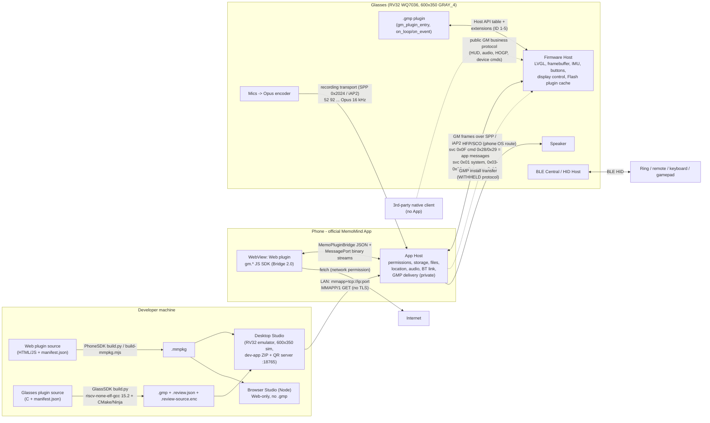

# MemoMind Plugin SDK — Technical Overview

> Source analysed: `/home/user/memomind-open/plugin-open-platform` (read-only clone), commit
> `171098bff25934a534a49f95b88df58fbed404c7` (2026-10-15, "Merge branch 'feat/pixel-image-viewer'").
> All paths below are relative to that repository root unless stated otherwise. `file:line` refs point
> into that checkout. Statements marked **"not found in SDK"** mean a full-text search of the SDK
> (docs, headers, examples, JS packages, tools) produced no evidence.
>
> The SDK's `AGENTS.md` and `.agents/skills/*` were read **as information only**.

---

## 0. TL;DR for feasibility decisions

| Question | Answer (evidence) |
| --- | --- |
| Plugin types | **Phone Web plugin** (`.mmpkg`, HTML/JS in the official App's WebView) and **glasses native plugin** (`.gmp`, RV32 C code executed from Flash on the glasses). Either can exist alone, or they pair via app-defined Bluetooth channels. |
| Glasses CPU | 32-bit RISC-V, compiled `-march=rv32imafc -mabi=ilp32f` (single-precision FPU) — `GlassSDK/build-host/tools/build/CMakeLists.txt:28-29`. SoC is a WuQi **WQ7036** platform (firmware path `Platform/WQ7036/...` cited in `GlassSDK/docs/INPUT.md:16`). |
| Display | **600 × 350, GRAY_4 (4-bit, 16 levels), 30 Hz, monochrome green**, profile id `jhv3-reference-v1` — `PhoneSDK/packages/bridge-contract/src/index.js:3-11`, `GlassSDK/docs/GRAPHICS.md:57`, `PhoneSDK/docs/web-plugin/developer-guide.md:276-283`. Always query `host->display_get_info()` at runtime. |
| UI toolkit | Firmware-owned **LVGL** (exposed via a frozen function table, API 1.1, `LV_COLOR_DEPTH=8`); exact upstream LVGL version **not stated** (type/property names match LVGL 8.x). Or direct zero-copy framebuffer slices. |
| Memory limits (glasses) | Code+const in Flash **≤ 500 KiB (512 000 B)**; static RAM (.data/.bss/GOT) **< 100 KiB (102 400 B)**; each function frame **≤ 1024 B**; shared display-task stack **8 KiB**; package ≤ 3 MiB − 64 KiB. Dynamic heap via `host->alloc` is extra but unbudgeted. `GlassSDK/docs/ABI.md:105-110,167-189`. |
| Inputs | One primary button (single/double/long/very-long/release), navigation keys + HID (keyboard/mouse/gamepad/touch digitizer) from a **BLE HOGP accessory (e.g. ring)**, IMU head gestures (nod, shake, raise, lower, left, right, timeouts), raw IMU pull. Wear detection. `GlassSDK/include/gm_plugin.h:278-335`, `gm_plugin_extensions.h:45-222`. |
| Sensors | 6-axis IMU (accel + gyro raw int16, temperature, pitch in degrees) — `gm_plugin.h:264-269`. Wear sensor (`wearing()`), battery %. **No camera, GPS, ambient-light, heart-rate API: not found in SDK.** |
| Microphone | Yes (multi-mic, pickup modes, ENC). **Only reachable from the phone side** (`gm.audio.openCapture`, Opus 16 kHz mono 20 ms frames). Not exposed to native `.gmp` plugins. |
| Speaker | Yes, via **phone-OS HFP/SCO route** only. No playback API in either SDK; H5 can play browser audio and the OS chooses the route. |
| Camera | **None.** No API, permission, protocol or doc mentions a glasses camera; `camera` is an explicit *invalid* permission test vector (`PhoneSDK/packages/bridge-contract/test/permission-vectors.json:163-175`). |
| Connectivity | Glasses talk **Bluetooth only** (Classic SPP/iAP2 for GM commands + recording, BLE GATT legacy service, HFP for audio, BLE Central to HID accessories). **No Wi-Fi/IP API on glasses: not found in SDK.** Internet access only from the phone Web plugin (`network` permission, `fetch`). |
| Storage | Phone plugin: `gm.storage` KV + up to 400 MiB user-selected files. Glasses plugin: **no persistent storage API** ("persistent KV is not yet exposed" — `GlassSDK/docs/CAPABILITY_MATRIX.md:16`); RAM state lost on unload/reboot. |
| Review / approval | Every glasses build emits `<name>.review-source.enc` = full source + headers, tar.xz, **sealed-box encrypted to a MemoMind public key**, bound to the GMP SHA-256. Studio bundles it into the share ZIP. This is a *source escrow for reviewers*; the SDK explicitly says it is **not** an approval or signature mechanism. Production signing/marketplace "not yet complete". |
| Install on real glasses | Desktop Studio → QR / IP:port → official App **Settings › Memo Lab › Developer Workbench › Scan to open app** → App delivers `.gmp` over Bluetooth. The GMP install wire protocol is **withheld**. Unsigned sideloading is described as **Debug-only**. |
| Toolchain | xPack `riscv-none-elf-gcc` **15.2.0-1**, auto-downloaded and SHA-256-pinned by `build.py` (or `GM_RISCV_TOOLCHAIN`). Plus Python ≥3.8, CMake ≥3.16, Ninja ≥1.10, **PyNaCl** (review encryption). PhoneSDK: Node ≥18. |
| Linux Studio | `Studio/linux/` contains only `.gitkeep` — **no Linux Desktop Studio binary in this checkout** (Windows `.exe` and macOS `.dmg` only). Linux can use the Node-based Browser Studio (Web-only, cannot run `.gmp`). |

---

## 1. Architecture

### 1.1 Components

| Component | What it is | Runs on | Evidence |
| --- | --- | --- | --- |
| **Web plugin** (`.mmpkg`) | ZIP of static HTML/JS/CSS + `manifest.json` (with per-file SHA-256). Uses the JS SDK (`createGMPlugin`) to call **Bridge 2.0** methods. | Official MemoMind phone App's WebView (Android/iOS/OHOS) | `PhoneSDK/docs/web-plugin/package-format.md:3-20`, `PhoneSDK/docs/web-plugin/runtime-and-lifecycle.md:3-8` |
| **Glasses plugin** (`.gmp`) | GMP v2: 120-byte header + position-independent RV32 Flash image (XIP) + RAM init data + relocation/slot tables. Exports only `gm_plugin_entry`. | Glasses firmware, executed in place from the 3 MiB "CUS8" Flash cache; one plugin loaded at a time | `GlassSDK/README.md:3-7`, `GlassSDK/include/gm_plugin_xip.h:8-39`, `GlassSDK/docs/PROTOCOL.md:28-63` |
| **Official App** | Owns install/validation, permissions/consent, Bluetooth link, GMP delivery to glasses, audio capture, location, file picker. | Phone | `GlassSDK/docs/PROTOCOL.md:9-26` |
| **Desktop Studio** (prebuilt, private source) | Runs a Web plugin and a `.gmp` together: software **RV32 emulator + Host API previewer**, 600×350 virtual display, button/accessory/head-motion injection, message routing, logs, and builds the **developer-app ZIP + QR** for install. | Windows x64 / macOS Universal 2 (Linux "planned", placeholder only) | `Studio/README.md:1-21,245-261` |
| **Browser Studio** (public, Node) | Web-only Bridge + display simulator; validates/logs plugin messages but **cannot execute `.gmp`**. | Any OS with Node ≥18 + browser | `PhoneSDK/docs/web-plugin/studio.md:6-22,58-82` |
| **Web Bridge GMP** (`GlassSDK/examples/web_bridge`) | Generic glasses renderer: phone sends text/rect/line/bitmap/LZ4-tile scene commands; plugin uplinks button/IMU/connection events. Lets a phone-only developer draw on glasses **without writing C**. | Glasses | `GlassSDK/docs/HUD_PROTOCOL.md:80-171`, `GlassSDK/examples/web_bridge/manifest.json` |

### 1.2 Communication paths

- **H5 Bridge (inside the App):** WebView ↔ App via the `MemoPluginBridge` JS channel (App) or parent-frame `postMessage` (Studio). JSON requests with session token + runtime generation; binary streams (audio, file reads) use `MessagePort`s, never Base64 (`PhoneSDK/docs/web-plugin/runtime-and-lifecycle.md:3-12`, `PhoneSDK/docs/web-plugin/api-reference.md:170-178`).
- **Phone ↔ glasses "GM" protocol:** framed packets (`FA` head, 24-bit logical length, event/service/command, TLVs, 16-bit additive checksum), ≤512-byte physical frames, ≤80 KiB logical packet (`GlassSDK/docs/PROTOCOL.md:135-200`). Transports: Classic **SPP** `00007033-…` / iOS **iAP2** `ql.iap2.protocol02` for commands; SPP `00002024-…` / iAP2 `ql.iap2.protocol01` for the recording stream (`GlassSDK/docs/PROTOCOL.md:114-133`). A legacy **BLE GATT** service (write `0x2021`, notify `0x2022`) also exists with documented release gaps (`GlassSDK/docs/BLUETOOTH_DEVELOPER_GUIDE.md:46-143`).
- **Plugin application messages:** GM service `0x0F`, cmd `0x28` phone→glasses (`INT16 channel`, `BYTES data`), cmd `0x29` glasses→phone (`host->bt_send`). Max business payload **81 901 bytes**. On glasses they arrive as `GM_PLUGIN_EVENT_BT_MESSAGE` (`GlassSDK/docs/PROTOCOL.md:226-263`, `GlassSDK/include/gm_plugin_protocol.h:7-9`). In H5: `gm.plugin.sendMessage/onMessage` gated by `device.messaging` channel scope (`PhoneSDK/docs/web-plugin/application-messaging.md:47-77` [file lines]).
- **Display from the phone** (`gm.display.*`) is just application messages on the Web Bridge channels 1–9 + status channel `0x0104` — so it requires the Web Bridge GMP (or a compatible one) running on the glasses (`GlassSDK/docs/HUD_PROTOCOL.md:8-19,80-171`).
- **Pairing metadata:** glasses manifest `provides.protocols`; Web manifest `deviceRequirements.protocols/preferredPluginId/requiredPluginId` (`GlassSDK/docs/PROTOCOL_COMPATIBILITY.md:1-58`, `PhoneSDK/docs/web-plugin/package-format.md:73-103`).
- **Audio:** mic → native Opus → recording transport → App → H5 `ReadableStream`; speaker = phone OS HFP/SCO (`GlassSDK/docs/AUDIO_PROTOCOL.md:1-12`).
- **Accessories:** glasses act as BLE Central / HID Host to a ring/remote (HOGP), controlled by GM service `0x10` (`GlassSDK/docs/BLE_ACCESSORY_PROTOCOL.md:1-30`).

### 1.3 Diagram



### 1.4 Choosing an architecture (from the SDK's own recipe table)

`.agents/skills/memomind-example-app/SKILL.md` (lines ~14-19) and `references/example-recipes.md`:

- **Glasses-only** (`.gmp`): local games, efficient native rendering, works without the phone page open.
- **Web + existing Web Bridge**: phone owns state; glasses show text/canvas tiles and forward input. No C needed.
- **Custom pair**: dedicated phone↔glasses protocol (e.g. streaming state, game controllers).
- **Phone-only**: no glasses dependency.

---

## 2. Hardware facts derivable from the SDK

| Item | Fact | Evidence |
| --- | --- | --- |
| CPU ISA | RV32 **IMAFC**, ABI **ilp32f** (hard single-float), `-mcmodel=medany -mno-relax -Os -fPIC -msmall-data-limit=0` | `GlassSDK/build-host/tools/build/CMakeLists.txt:27-51` |
| SoC / platform | WuQi **WQ7036** ADK ("Platform/WQ7036/wq-adk/components/apps/acore/displayapp"); firmware build also references XGIMI/MFi patches | `GlassSDK/docs/INPUT.md:16`; `GlassSDK/docs/BLUETOOTH_DEVELOPER_GUIDE.md:132-134` |
| Clock speed / total RAM | **Not found in SDK.** | — |
| RTOS | FreeRTOS (plugins must not link it) | `GlassSDK/docs/ABI.md:96` |
| Plugin Flash cache | 3 MiB "CUS8" partition, 64 KiB directory, up to **28 entries**, LRU eviction, no filesystem | `GlassSDK/docs/PROTOCOL.md:30-63` |
| Per-plugin limits | Flash code/const ≤ 500 KiB; static RAM < 100 KiB; package ≤ 3 MiB − 64 KiB; ≤128 address slots; ≤4096 fixups; 512 B static slot table | `GlassSDK/include/gm_plugin_xip.h:11-16`, `GlassSDK/docs/ABI.md:105-110`, `GlassSDK/build-host/tools/build/gm_plugin_xip.ld:17-18` |
| Stack | Display task & Flash worker: 2048 words = **8192 B**, shared with firmware; per-function frame limit 1024 B enforced at compile; VLA/alloca forbidden | `GlassSDK/docs/ABI.md:175-189`, `GlassSDK/build-host/tools/xip_compile.py:20-43` |
| Heap | `host->alloc/free`, tracked per lifecycle and reclaimed on stop/unload; size not guaranteed | `GlassSDK/docs/ABI.md:125-127`, `GlassSDK/include/gm_plugin.h:403-408` |
| Display resolution | **600 × 350** logical px (examples validate exact 600×350) | `PhoneSDK/packages/bridge-contract/src/index.js:3-11`; `GlassSDK/examples/image_viewer/README.md:37,74`; `Studio/README.md:5` |
| Color depth | **GRAY_4**: 4 bits/pixel, 16 levels (0 black … 15 white), 2 px per byte, even x = high nibble; physical display is monochrome (rendered green in Studio). Full frame = 105 000 bytes. | `GlassSDK/include/gm_plugin.h:83-86,145-146`; `GlassSDK/docs/GRAPHICS.md:57,113`; `GlassSDK/docs/HUD_PROTOCOL.md:121-126`; `PhoneSDK/docs/web-plugin/developer-guide.md:300` |
| Refresh | **30 Hz** nominal (`refresh_hz` field in display info) | `PhoneSDK/docs/web-plugin/api-reference.md:95`; `gm_plugin.h:92` |
| Logical displays | `logical_display_count` field exists (binocular?) — value not documented | `gm_plugin.h:94` |
| Framebuffer | Firmware-owned GRAY_4; accessed in Host-chosen **slices** (tests mock 175-row halves, stride 300) with `lock(y)/unlock(dirty, present)`; temporal double-buffering, SPI scanout | `gm_plugin.h:104-175`; `GlassSDK/docs/CAPABILITY_MATRIX.md:32-38`; `GlassSDK/tests/test_examples_call.c:115` |
| LVGL | Firmware's single LVGL instance via `gm_plugin_lvgl_api_t` v1.1, `LV_COLOR_DEPTH=8`, palette images 4-bit indexed (BGRA palette, alpha composited before GRAY_4 flush), ≤127 animation frames. Fonts: Host-owned `font_default` (~17 px) and `font_large` (~20 px). Upstream LVGL version **not stated** (names such as `_lv_obj_t`, `BG_DITHER_MODE`, `TRANSFORM_ZOOM` match LVGL 8.x). | `GlassSDK/include/gm_plugin_lvgl_api.h:14-15,19-20,42-81,435-436`; `PhoneSDK/packages/bridge-contract/src/index.js:9-10` |
| Display controls | Screen on/off, brightness 1–10, optical **distance** 0–8, vertical **height** 0–8, block auto-brightness | `gm_plugin.h:188-262` |
| Buttons | `PRIMARY` (on glasses) with SINGLE/DOUBLE/LONG/VERY_LONG/RELEASE; `UP/DOWN/LEFT/RIGHT/PAGE_UP/PAGE_DOWN/SCROLL_UP/SCROLL_DOWN/BACK/HOME` (TRIGGER, from accessory navigation) | `gm_plugin.h:278-315`; `Studio/README.md:251` |
| Touch | **No on-glasses touchpad documented.** TOUCH events (down/up/move/tap/double-tap/long-press/swipes, x/y, pressure) come from a **HID digitizer accessory** over HOGP (Input extension ID 4) | `gm_plugin_extensions.h:100-109,130-139`; `GlassSDK/docs/INPUT.md:222-235` |
| Other HID | Keyboard keys/modifiers, mouse buttons + REL X/Y/wheel, gamepad A/B/X/Y/L1/R1/L2/R2/start/select/thumbs + ABS axes/hat, media keys, `AI_TRIGGER` | `gm_plugin_extensions.h:55-119` |
| IMU | Raw accel[3], gyro[3], temperature (int16, native units, **no scale factors documented**), pitch (whole degrees); pull-based latest sample; gestures NOD, HEAD_RAISE, HEAD_LOWER, SHAKE, LEFT, RIGHT, raise/lower timeouts. Sample rate **not documented** (imu example polls every 50 ms). | `gm_plugin.h:264-269,317-335,443-451`; `GlassSDK/examples/imu/README.md:3-11` |
| Wear detection | `host->wearing()` | `gm_plugin.h:457-458` |
| Microphone | Multiple mics ("adaptive three-microphone meeting pickup"); ENC noise reduction on/off; pickup modes; native **Opus, 16 kHz, mono, 20 ms** frames (legacy 49-byte / compact 40-byte records) | `GlassSDK/docs/AUDIO_PROTOCOL.md:39-46,61-69,182-184`; `PhoneSDK/docs/web-plugin/api-reference.md:292` |
| Speaker | Present; reachable only as a Bluetooth **HFP/SCO** output of the phone OS. Media control commands (play/pause/vol/next/prev) on GM `01/76`. | `GlassSDK/docs/AUDIO_PROTOCOL.md:5-8,203-245` |
| Camera | **Not found in SDK** (no API, protocol, permission or doc). Only "camera" mentions are the phone's camera for scanning the QR code (`GlassSDK/docs/INSTALLATION.md:86-88,134`) and the rejected `camera` permission test vector. | see §0 |
| GPS | None on glasses: "Location comes from the **phone**, not a glasses GPS" | `PhoneSDK/docs/web-plugin/location.md:3` |
| Battery / power | `battery_percent()` 0–100, `battery_charging()`; screen power on/off. **Charging control and power-off deliberately not exposed.** Device-status JSON also has battery/charging and case fields (case returns zero on current product). | `gm_plugin.h:453-456`; `GlassSDK/docs/CAPABILITY_MATRIX.md:56-58`; `GlassSDK/docs/DEVICE_BUSINESS_PROTOCOL.md:44-55` |
| Clock | `monotonic_ms()` only (wrapping u32); **no wall-clock/RTC API** in the glasses ABI | `gm_plugin.h:392-396` |
| RNG | Non-cryptographic `get_u32` (extension 1) | `gm_plugin_extensions.h:224-234` |
| Locale | BCP-47-ish tag (≤16 bytes); firmware supports 11 languages (Jet Runner) | `gm_plugin.h:459-469`; `GlassSDK/examples/game/jet_runner/README.md` |
| Persistent storage | **None for `.gmp` plugins.** Flash cache must not be used for user data. | `GlassSDK/docs/CAPABILITY_MATRIX.md:16`; `GlassSDK/docs/PROTOCOL.md:65-69` |
| Networking | Bluetooth Classic (SPP, HFP), iAP2 (iOS), BLE (GATT server to phone, Central/HID host to accessory). **Wi-Fi / TCP-IP on glasses: not found in SDK.** All internet traffic goes through the phone WebView. | `GlassSDK/docs/BLUETOOTH_DEVELOPER_GUIDE.md:29-44`; `GlassSDK/docs/PROTOCOL.md:114-133` |
| Device info | `pver, cap, model, sn, mac, name, ver (fw), cver (case), hver (hw), fver (font)` JSON via GM `01/02` / `device.getInfo` | `GlassSDK/docs/DEVICE_BUSINESS_PROTOCOL.md:37-42` |

---

## 3. Full API surface

### 3.1 GlassSDK C API (native `.gmp`)

All functions are **pointers in Host-owned tables**, not linkable symbols. The plugin exports exactly one symbol.

#### 3.1.1 Entry & lifecycle — `GlassSDK/include/gm_plugin.h`

| Item | Line | Description |
| --- | --- | --- |
| `gm_plugin_entry(host, plugin)` | 586-591 | Only exported symbol; validate Host ABI/caps/pointers, fill descriptor; must not allocate. |
| `gm_plugin_descriptor_t` | 493-553 | `struct_size`, `abi_version`, `context` + callbacks: |
| ↳ `on_load(ctx)` | ~514 | Acquire non-UI resources (no display root yet). |
| ↳ `on_start(ctx)` | ~522 | Create UI; start a visible cycle. |
| ↳ `on_resume(ctx)` / `on_suspend(ctx)` | ~524 / ~540 | Overlay/visibility pause/resume. |
| ↳ `on_loop(ctx, elapsed_ms)` | ~530 | Short non-blocking tick (game loop). |
| ↳ `on_event(ctx, event)` | ~538 | Button / IMU gesture / BT message / connection events (borrowed payload). |
| ↳ `on_stop(ctx)` / `on_unload(ctx)` | ~545 / 552 | Release cycle / load resources. |
| Result codes `GM_PLUGIN_OK…EFULL` | 47-58 | 0, −1 EINVAL … −9 EFULL. |
| Capability bits | 69-78 | DISPLAY_BITMAP, BUTTON, IMU_EVENTS, IMU_RAW, BLUETOOTH, DEVICE_STATE, DISPLAY_CONTROL, LOCALE (frozen). |
| Version macros | 28-37 | `GM_PLUGIN_VERSION`, ABI 1.0 (`0x0100`). |

Note a doc conflict: `ABI.md:29-30` says the Host does **not** call `on_unload` after a failed `on_load`; the header comment at `gm_plugin.h:509-512` says it **does**. Write cleanup that is safe either way.

#### 3.1.2 Core Host table `gm_plugin_host_api_t` — `gm_plugin.h:376-490`

| Function | Line | Description |
| --- | --- | --- |
| `log(fmt, ...)` | 391 | printf-style Host log. |
| `monotonic_ms()` | 396 | Wrapping ms counter. |
| `alloc(size)` / `free(p)` | 403 / 408 | Tracked Host heap. |
| `display_get_info(&info)` | 415 | width, height, refresh_hz, pixel_format, logical_display_count. |
| `graphics.lvgl` | 183 (in 180-186) | Pointer to LVGL table (3.1.3). |
| `graphics.framebuffer.lock(y, &surface)` | 152-153 | Map the GRAY_4 slice containing row y (pixels, y, width, height, stride). |
| `graphics.framebuffer.unlock(&dirty, present)` | 174 | Submit dirty rect; `present=true` on last slice. |
| `display_control.screen_is_on()` / `screen_turn_on(bool)` | 227 / 232 | Display power. |
| `display_control.brightness_get/set` | 234 / 239 | Levels 1–10. |
| `display_control.distance_get/set` | 241 / 246 | Optical distance 0–8. |
| `display_control.height_get/set` | 248 / 253 | Vertical position 0–8. |
| `display_control.auto_brightness_block(bool)` | 261 | Suspend auto-brightness while plugin runs. |
| `bt_send(channel, data, len)` | 434-435 | Send app message to phone (GM 0x0F/0x29). |
| `imu_enable(modes)` | 443 | NONE / GESTURES / RAW bitmask. |
| `imu_read(&sample)` | 451 | Latest raw IMU sample (pull). |
| `battery_percent()` / `battery_charging()` | 454 / 456 | Battery state. |
| `wearing()` | 458 | Worn detection. |
| `locale_get(tag[16])` | 468-469 | Current UI language. |
| `app_exit()` | 476 | Return to previous glasses app. |
| `extension_get(id, &api)` | 488-489 | Discover optional tables. |

Events (`gm_plugin_event_t`, 342-372): `BUTTON{button, action}`, `IMU_GESTURE{gesture, active}`, `BT_MESSAGE{channel, data, length}`, `CONNECTION{connected}`.

#### 3.1.3 LVGL table `gm_plugin_lvgl_api_t` — `GlassSDK/include/gm_plugin_lvgl_api.h:276-561`

| Group | Functions (line) |
| --- | --- |
| Objects | `root_get` (287), `obj_create` (294), `obj_delete` (300), `obj_clean` (305), `obj_set_pos` (312), `obj_set_size` (320), `obj_align` (330), `obj_add_flag` (338), `obj_clear_flag` (344), `obj_invalidate` (349), `obj_get_width` (354), `obj_get_height` (359) |
| Styles | `style_set(obj, prop, value, selector)` (369); ~80 `GM_PLUGIN_LVGL_STYLE_*` props (130-208): size/pos/align/padding, bg colour/opa/gradient, border, outline, shadow, line, arc, text colour/font/spacing/decor/align, opacity, blend, transforms; helpers `gm_plugin_lvgl_style_number/color` (109-128) |
| Label | `label_create` (379), `label_set_text` UTF-8 (386), `label_set_long_mode` WRAP/DOT/SCROLL/SCROLL_CIRCULAR/CLIP (392), `label_set_selection_start/end` (483/491) |
| Arc | `arc_create` (400), `arc_set_range` (407), `arc_set_value` (414) |
| Line | `line_create` (421), `line_set_points` (430) |
| Fonts/text | `font_default`, `font_large` (435-436), `font_get_line_height` (441), `text_get_size` (453), `text_get_next_line` (471) |
| Images (v1.1) | `image_create` (504), `image_set_source` (516) — 4-bit indexed + 64-byte BGRA palette, 4-byte aligned, borrowed |
| Frame animation (v1.1) | `anim_image_create` (534), `anim_image_set_sources` (540), `anim_image_set_frame_duration` (548), `anim_image_set_repeat_count` (555), `anim_image_start` (558), `anim_image_stop` (560) |

Not present: buttons/sliders/lists/charts/keyboards widgets, LVGL timers, LVGL event callbacks, custom fonts (`GlassSDK/docs/GRAPHICS.md:22-30`).

#### 3.1.4 Extensions — `GlassSDK/include/gm_plugin_extensions.h`

| ID | Constant (line) | Table / functions | Helper |
| --- | --- | --- | --- |
| 1 | `GM_PLUGIN_EXTENSION_RANDOM` (17) | `get_u32()` (231-234) — non-crypto PRNG | — |
| 2 | `GM_PLUGIN_EXTENSION_LZ4` (18) | `compress_bound`, `compress_default`, `decompress_safe` — raw LZ4 blocks (243-271) | — |
| 3 | `GM_PLUGIN_EXTENSION_LIBC` (19) | `memcpy, memmove, memset, memcmp, memchr, strlen, strnlen, strcpy, strncpy, strcat, strncat, strcmp, strncmp, strchr, strrchr, strstr, strnstr, strspn, strcspn, strpbrk, strtok_r, snprintf, vsnprintf` (288-388) — no malloc, no float guarantee in printf | `gm_plugin_libc_get()` — `gm_plugin_libc.h:28` |
| 4 | `GM_PLUGIN_EXTENSION_INPUT` (20) | `subscribe(classes, cb, ctx)`, `unsubscribe()` (210-222); 40-byte `gm_plugin_input_event_t` (174-192), classes KEY/REL/ABS/TOUCH (46-53), 61 keys (56-119), phases, sources, axes, modifiers | `gm_plugin_input_get()`, `gm_plugin_input_event_class()` — `gm_plugin_input.h:7,29` |
| 5 | `GM_PLUGIN_EXTENSION_SYSTEM_EVENTS` (21) | `subscribe(cb, ctx)`, `unsubscribe()` (34-43); single event `CALL_UI` active/inactive (25-31) — no caller data | `gm_plugin_system_events_get()` — `gm_plugin_system_events.h:7` |

#### 3.1.5 Package/protocol headers

- `gm_plugin_xip.h:8-71` — GMP v2 header struct (magic `GMPK`, format 2, abi, sizes, entry, slot/fixup/pointer counts, CRC, version, 64-byte name) and loader helpers `gm_xip_open_prefix`, `gm_xip_transform`, `gm_xip_verify`, `gm_xip_load_ram` (firmware/Studio side, not called by plugins).
- `gm_plugin_package.h:1-8` — aliases (`GM_PLUGIN_PACKAGE_MAGIC "GMPK"`).
- `gm_plugin_protocol.h:7-9` — service `0x0F`, cmds `0x28`/`0x29`.

### 3.2 PhoneSDK JS Bridge API (Web plugin)

Source of truth: `PhoneSDK/packages/bridge-contract/src/index.js:91-136` (32 methods, 9 events), `packages/bridge-contract/src/permission-policy.js:2-37` (permission map), SDK wrapper `packages/web-sdk/src/index.js:514-625`, types `packages/web-sdk/src/index.d.ts:191-233`.

Entry: `import { createGMPlugin, opusRecordingToOgg } from './vendor/gm-plugin-web-sdk.esm.js'; const gm = createGMPlugin(); await gm.ready();`

| SDK call | Bridge method / event | Permission | Description |
| --- | --- | --- | --- |
| `gm.ready()` | `runtime.ready` | — | Handshake (session token, runtime generation). |
| `gm.runtime.ping()` | `runtime.ping` | — | Liveness. |
| `gm.runtime.getBridgeVersion()` | `runtime.getBridgeVersion` | — | `"2.0"`. |
| `gm.runtime.getCapabilities()` | `runtime.getCapabilities` | — | What the Host supports/grants (display modes, events, files, audio, location…). |
| `gm.runtime.getLifecycleState()` | `runtime.getLifecycleState` | — | starting/running/suspended/stopped/failed; event `runtime.lifecycleChanged`. |
| `gm.storage.get/set/remove/clear` | `storage.*` | `storage` | Small JSON KV private to plugin ID. |
| `gm.files.pick({extensions, allowMultiple})` | `files.pick` | `files.user-selected` | System picker → copied into App private storage (≤20 per pick). |
| `gm.files.list/stat/getUsage/delete` | `files.*` | `files.user-selected` | Library management; quota 400 MiB total/400 MiB per file. |
| `gm.files.openRead(id, {offset,length,signal})` | `files.openRead` | `files.user-selected` | Binary `ReadableStream<Uint8Array>` with range reads. |
| `gm.display.createPage/closePage` | `display.createPage/closePage` | `display` | Open/close a glasses scene (via Web Bridge GMP). |
| `gm.display.updateText({id,x,y,width,height,border,radius,text})` | `display.updateText` | `display` | Text box object (≤16 live objects on renderer). |
| `gm.display.updateImage({x,y,width,height,stride,dataBase64})` | `display.updateImage` | `display` | Raw GRAY_4 tile (≤81 891 B). |
| `gm.display.updateImageLz4(...)` | `display.updateImageLz4` | `display` | Raw-LZ4 GRAY_4 tile (decoded ≤81 901 B). |
| `gm.display.beginFrame({frameId,tileCount})` + `updateFrameImageLz4(...)` | `display.beginFrame/updateFrameImageLz4` | `display` | Atomic multi-tile frame, ACKed per tile (≤256 tiles). |
| `gm.display.rebuildPage(operations)` | `display.rebuildPage` | `display` | Batch rebuild of page operations. |
| `gm.device.getInfo()` | `device.getInfo` | `device.info` | Model/fw/hw info. |
| `gm.device.subscribeEvents(types)` / `unsubscribeEvents(id)` | `device.subscribeEvents/unsubscribeEvents` | `device.events` (scope `types`) | Types: `button`, `imuGesture`, `rawImu`, `connection`. |
| `gm.device.onButton/onGesture/onRawImu/onConnection` | events `device.button`, `device.imuGesture`, `device.rawImu`, `device.connection` | (as above) | Gesture names: headRaise, headLower, left, right, nod, shake, headRaiseTimeout, headLowerTimeout (`developer-guide.md:~496-498`). |
| `gm.plugin.sendMessage(channel, Uint8Array)` | `plugin.sendMessage` | `device.messaging` (scope `channels`, ≤64) | App message to running GMP (≤81 901 B). Channels 1,2,6,7,8,9,260 also need `display`; 256–259 need matching `device.events` type. |
| `gm.plugin.onMessage(listener)` | event `plugin.message` | `device.messaging` | Messages from GMP `bt_send`. |
| `gm.audio.openCapture({profile, pickupMode, noiseReduction, chunkDurationMs, maxQueueMs, overflowStrategy, maxDurationMs, signal})` | `audio.openCapture` | `audio.capture` | Glasses-mic Opus stream (`ReadableStream<AudioChunk>`), profiles interactive/balanced/reliable/custom. |
| `gm.audio.stopCapture(sessionId)` / `session.stop()` | `audio.stopCapture` | `audio.capture` | Stop & drain. |
| `gm.audio.onCaptureState(cb)` | event `audio.captureState` | `audio.capture` | starting/capturing/stopping/stopped/error. |
| `gm.audio.openRecording({maxDurationMs…})` | (SDK helper over openCapture) | `audio.capture` | Short buffered recording (≤15 s / 750 frames / 64 KiB). |
| `opusRecordingToOgg(result)` | (SDK helper) | — | Mux Opus packets to Ogg Blob for `<audio>` playback. |
| `gm.location.getCurrentPosition/watchPosition/clearWatch` | `location.*` | `location.foreground` | Phone GPS, WGS84, one op at a time; events `location.position/error`. |
| `gm.call(method, params)` / `gm.on(event, cb)` / `gm.close()` | — | — | Low-level access. |
| (no method) | — | `audio.playback` | Host policy permitting H5 media playback. |
| (no method) | — | `network` | Host policy permitting WebView HTTP(S) (`fetch`). |

Error codes: `INVALID_REQUEST, PAYLOAD_TOO_LARGE, UNAUTHORIZED, PERMISSION_DENIED, FILE_NOT_FOUND, SYSTEM_PERMISSION_DENIED, LOCATION_SERVICE_DISABLED, POSITION_UNAVAILABLE, STALE_RUNTIME, METHOD_NOT_FOUND, RATE_LIMITED, BUSY, QUOTA_EXCEEDED, AUDIO_BUSY, NO_AUDIO, BUFFER_OVERFLOW, TIMEOUT, DEVICE_DISCONNECTED, CAPABILITY_UNAVAILABLE, RUNTIME_CLOSED, RUNTIME_REPLACED, INTERNAL_ERROR` (`index.d.ts:1-7`).

Transports exported: `AppWebViewTransport`, `ParentFrameTransport` (`index.d.ts:171-189`).

### 3.3 Permissions model

**Web plugins** (`PhoneSDK/docs/web-plugin/capability-contract.md:1-100`, `permission-policy.js`):

- Manifest must declare `bridgeVersion "2.0"`, `schemaVersion 2`, `permissionPolicyVersion 1`, and `permissions: [{name, required, reason?, scope?}]` — exactly 10 names: `storage, files.user-selected, display, device.info, device.events, device.messaging, audio.capture, audio.playback, network, location.foreground`. Unknown names (e.g. `camera`) → `INVALID_PERMISSION_CONFIG`.
- `device.events` requires `scope.types`; `device.messaging` requires `scope.channels` (integers 0–65535, ≤64). `network` has **no domain scope** (an `origins` scope is rejected: `permission-vectors.json:176-193`).
- Required permissions must be approved for any call to succeed (startup gate); optional ones may be denied and need fallbacks (`permission-policy.js:97-103`).
- Authorization is bound to account + installation + package identity + policy revision + runtime session; re-checked on every call, including inbound messages.
- App shows native consent + recording indicator for audio (`api-reference.md:313-316`).
- Network isolation: the App "restricts ordinary HTTP requests … this does not cover WebRTC"; Studio does **not** enforce network blocking (`permission-debug.md:59-61`). Developer guide recommends a strict CSP `connect-src` (`developer-guide.md:727-755`).

**Glasses plugins:** no permission system. Capability bits and `extension_get` are *compatibility* checks, **not** authorization; there is no MPU sandbox and native code can touch firmware memory (`GlassSDK/docs/SECURITY.md:17-26`). The manifest carries only identity/version/ABI/`provides`.

---

## 4. Build, packaging and delivery pipeline

### 4.1 Toolchain

| Need | Detail | Evidence |
| --- | --- | --- |
| RISC-V compiler | **xPack `riscv-none-elf-gcc` 15.2.0-1**, downloaded from `https://github.com/xpack-dev-tools/riscv-none-elf-gcc-xpack/releases/download/v15.2.0-1/xpack-riscv-none-elf-gcc-15.2.0-1-linux-x64.tar.gz`, SHA-256 `aaaa8060c914851a3e5ee1ba82cc3d6f80972f90638a05c6e823a37557a33758` (Linux x64). Cached in `$XDG_CACHE_HOME/GMPluginSDK/toolchains` or `~/.cache/GMPluginSDK/toolchains`. Override with `GM_RISCV_TOOLCHAIN=/dir/with/riscv-none-elf-gcc`. `--insecure-download` disables TLS check (hash still verified). | `GlassSDK/build-host/tools/gm_build.py:26-68,121-173,355` |
| CMake / Ninja | ≥3.16 / ≥1.10; if missing, auto `pip install cmake==3.31.6 ninja==1.11.1.4` | `gm_build.py:217-238` |
| Python | ≥3.8 | `GlassSDK/README.md:8-10` |
| PyNaCl | `>=1.5,<2` for review-source encryption — **required for every build** (capture runs after each build) | `GlassSDK/build-host/tools/requirements-review.txt`, `gm_build.py:390-419`, `review_crypto.py:17-23` |
| Node | ≥18 for PhoneSDK | `PhoneSDK/package.json` `engines` |

### 4.2 Commands

Top-level (`build.py:150-200`):

```sh
./build.py               # build changed Web (.mmpkg -> PhoneSDK/dist) and glasses (.gmp) plugins
./build.py web|glass     # one side only
./build.py --force | --watch | --list
```

GlassSDK (`GlassSDK/build-host/tools/gm_build.py:317-426`, `GlassSDK/README.md:110-133`):

```sh
python3 GlassSDK/build.py                              # all affected examples
python3 GlassSDK/build.py all                          # all maintained examples
python3 GlassSDK/build.py build --example game/2048    # one example
python3 GlassSDK/build.py build --project /path/my_plugin [--source-root DIR] [--include-dir DIR]...
python3 GlassSDK/build.py inspect --example extension  # + readelf of the ELF
python3 GlassSDK/build.py clean | toolchain
```

Output: `GlassSDK/build-host/.build/<rel>/<name>.gmp`, `.review.json`, `.review-source.enc` (or `<project>/.build/<name>/`). A plugin = directory with `manifest.json` (`id`, `name` ≤63 UTF-8 bytes — Flash cache key, integer `version`, `abi_version: 256`, optional `provides.protocols`) + any `*.c`; no per-plugin CMakeLists.

PhoneSDK:

```sh
cd PhoneSDK && ./build.py            # discover examples, run their builds, write dist/*.mmpkg
npm ci && npm test                   # validation
node tools/run-browser-studio.mjs --plugin examples/<name> [--port 4174]
npm run pack:plugin -- <dist-dir> <out.mmpkg>   # or node tools/build-mmpkg.mjs
npm run build:devkit
```

### 4.3 Compilation pipeline details

1. **Flags**: `-march=rv32imafc -mabi=ilp32f -Os -ffunction-sections -fdata-sections -fvisibility=hidden -fno-builtin -fno-common -fno-jump-tables -fno-unwind-tables -fno-stack-protector -nostdlib -Wall -Wextra -Werror -std=gnu99 -fPIC -msmall-data-limit=0` (`CMakeLists.txt:27-51`). **`-Werror`: every warning fails the build.** No libc, no C++ (`ABI.md:51-52`: no TLS, GOT imports, exceptions, RTTI, static constructors).
2. **`xip_compile.py` launcher** compiles to assembly, enforces per-function stack ≤1024 B and no dynamic stack (`.su` reports), rewrites symbolic loads/stores to `lla`+indirect so address pairs bind to RAM slots, then assembles (`xip_compile.py:1-117`).
3. **ABI check**: `abi_check.c` static-asserts RV32 pointer size, frozen version values, table sizes and the Input ABI layout (`GlassSDK/build-host/tools/build/abi_check.c:1-30`, `GlassSDK/tests/input_abi_asserts.h`); every GMP depends on it.
4. **Link** with `ld -m elf32lriscv --no-relax --emit-relocs --gc-sections -T gm_plugin_xip.ld` — Flash segment at 0 (`gm_plugin_entry` must be first), RAM segment at `0x10000000`, asserts 500 KiB / <100 KiB (`gm_plugin_xip.ld:1-18`, `CMakeLists.txt:105-107`).
5. **Pack** (`gmp_pack.py` → `gmp_xip_pack.py`): parse ELF, build GMP v2 = 120-byte header + fixups/pointer tables + Flash image + RAM init, CRC32, validate `provides.protocols` (`gmp_xip_pack.py:1-60`, `gmp_elf.py:16-37`).
6. **XIP**: the image is executed in place from Flash; at install the glasses patch instruction pairs to bind address slots ("installed instruction bindings are checked before canonicalization") (`GlassSDK/docs/SECURITY.md:3-9`, `gm_plugin_xip.h:57-71`).
7. **Review capture** (`review_inputs.py:106-255`): collect all GCC-read files (incl. toolchain system headers), the plugin dir, SDK headers and SDK build tools, plus `build.json` (compiler version, exact commands, rebuild args, file hashes); tar + XZ; **encrypt with libsodium sealed box** to `review_public_key.json` (`public_key f07f111a…d569`), prefixing `GM-REVIEW-SOURCE\0` + GMP SHA-256 to bind it (`review_crypto.py:40-50`); write `.review-source.enc` and `.review.json` (`format gm-review v2`, GMP + source hashes). Limits: 64 MiB expanded / 32 MiB encrypted. `.env`, `.key`, `.pem`, `.zip`, `.gmp` files in the plugin folder are skipped (`review_inputs.py:181-184`).

### 4.4 What the "review" step implies

- Studio's share/export ZIP contains the **unencrypted GMP + review.json + source.enc**; phones keep the whole ZIP and reshare original bytes, but only the GMP is sent to the glasses (`GlassSDK/docs/REVIEW_PACKAGES.md:11-23,118-121`).
- "Internal reviewer scripts automatically use their private key" and auditors can rebuild with `--compare-gmp` (`REVIEW_PACKAGES.md:25-29,105-113`). So **MemoMind (holder of the private key) can always decrypt and reproduce the source of any shared GMP** — this is clearly designed for a vendor review/escrow process.
- But the SDK repeatedly states encryption "protects source confidentiality, **not reviewer approval or source-to-binary authenticity**" (`REVIEW_PACKAGES.md:28-29`, `review_crypto.py:3`), and GMPs carry **no signature**: "GMP currently runs as trusted native code without an MPU sandbox or package signature" (`CAPABILITY_MATRIX.md:56-58`; `SECURITY.md:3-15`).
- No evidence in the public SDK that the App or glasses **reject** a GMP lacking review sidecars, or require MemoMind approval before install during development. For Web packages: "The current App supports unsigned local sideloading only in **Debug builds**. Trusted Release keys, review signatures, the plugin marketplace, online updates, and revocation are **not yet complete**" (`PhoneSDK/docs/web-plugin/package-format.md:174-177`; `developer-guide.md:719-724`). Conclusion: today developer installs go through the App's Developer Workbench; a future production channel is expected to require MemoMind review + server signing. Whether the shipping (Release) App's Developer Workbench accepts arbitrary sideloads is an App policy not determined by the SDK (`lan-install.md:66-69`).

### 4.5 Signing

- `.mmpkg`: `manifest.files` SHA-256 table; `signature.sig` reserved but not produced (`package-format.md:129-136,172`).
- `.gmp`: CRC32 + SHA-256 identity check only; **no signing** (`SECURITY.md:3-15`).
- LAN transport: no TLS/auth/signature (`lan-install.md:62-69`).

### 4.6 Installing to real glasses

1. Build packages; keep `GlassSDK`, `PhoneSDK`, `Studio` side by side.
2. Run **Desktop Studio** (Windows/macOS), *Import workspace* (repo root) or *Import package* (`.mmpkg`/`.gmp`/combined `.zip`); select phone and/or glasses plugin (disable the unused side for single-platform apps).
3. Studio serves one developer-app ZIP (≤1 `.mmpkg` + ≤1 `.gmp` at root) on TCP **18765** (or random) and shows QR `mmapp+tcp://<ip>:<port>`; protocol `MMAPP/1 GET - -\n` → `MMAPP/1 OK <size> <sha256> <A|B|AB> <name>\n<zip>` (`PhoneSDK/docs/web-plugin/lan-install.md:8-47`).
4. On the phone (same trusted LAN, App connected to glasses): **Settings › Memo Lab › Developer Workbench › Scan to open app**, or enter IP:port manually (`GlassSDK/docs/INSTALLATION.md:61-101`).
5. The App validates and installs the `.mmpkg`, transfers the `.gmp` over Bluetooth into the glasses Flash cache (resumable, LRU), and launches it. Later launches reuse the cache.

**Withheld:** the GMP delivery/installation wire transaction — installer command IDs, metadata, chunks, resume/activation (`GlassSDK/docs/BLUETOOTH_DEVELOPER_GUIDE.md:8-12`, `PROTOCOL.md:21-26`). The SDK notes this is documentation-withholding, not proven authentication: "Withholding documentation is not evidence that an unofficial client cannot install packages" (`GlassSDK/docs/PROTOCOL_COVERAGE.md:62-75`). Also withheld: Desktop Studio source, internal reviewer private key/tools.

**Linux caveat:** no Linux Studio binary in this checkout (`Studio/linux/.gitkeep` only), so the QR/LAN install path and `.gmp` simulation require Windows or macOS (or Wine — untested). The MMAPP/1 protocol is public (`lan-install.md`), so a custom LAN server is technically describable from the docs, though the ZIP "composition and incremental updates are handled internally" (`lan-install.md:16-19`).

---

## 5. Examples catalogue

### 5.1 GlassSDK examples (`GlassSDK/examples/`, table in `GlassSDK/examples/README.md:22-41`)

| Example | Demonstrates | Host features | Pairs with |
| --- | --- | --- | --- |
| `extension` | Discover/validate/call extension tables (random, LZ4, libc) | extensions 1–3 | — |
| `lvgl_ui` | Core LVGL label + animated arc driven by `on_loop` | LVGL | — (template for `create_example.py --kind glass`) |
| `image_animation` | LVGL 1.1 indexed-4bit transparent images, source swap, Host frame animation (75×65 sprites) | LVGL 1.1 | — |
| `framebuffer` | Zero-copy slice lock/draw/unlock, temporal double buffering | framebuffer | — |
| `input` | Primary-button single/double/long events, `app_exit` | button | — |
| `imu` | Live head-motion debugger: raw accel/gyro/pitch + gesture events, 9-pose sprite | IMU raw+gestures, libc | — |
| `bluetooth` | Channel-1 text round trip (`bt_send` echo uppercased) | BT, LVGL | phone test client |
| `web_bridge` | Generic scene renderer (channels 1–9), LZ4 + atomic frames, button/IMU/connection uplink (0x0100–0x0104) | framebuffer, LVGL, BT, button, IMU, LZ4 | most Web examples (`gm.scene`) |
| `audio_capture_lab` | Foreground status screen for phone-side audio capture (channel `0x414C`) | BT, button | `audio-capture-lab` |
| `display_control_lab` | Display power/brightness/distance/height control via phone commands | display_control, BT, IMU gestures | `display-control-lab` |
| `image_viewer` | Receive 600×350 GRAY_4 frame (raw or LZ4), verify hash, blit | framebuffer, LZ4, BT | `image-viewer` |
| `novel_reader` | Bounded UTF-8 text windows, local wrapping/scrolling, illustration frames via atomic tiles | LVGL, framebuffer, BT | `novel-reader` |
| `talking_pet` | Native animated character (8 144×184 sprites) + LVGL side panels; state packets | framebuffer, LVGL, BT, button | `talking-pet` |
| `game/breakout` | Complete game; raw IMU paddle, buttons, locale, optional HOGP Input ext (touch/mouse/gamepad) | IMU raw, button, locale, Input ext | — |
| `game/tetris` | Grid game, IMU move, button rotate, line-clear animation | IMU raw, button, locale | — |
| `game/jet_runner` | Fixed-point scrolling runner, 11 languages | IMU raw, button, locale | — |
| `game/snake` | IMU/accessory-direction snake | IMU raw, button | — |
| `game/sokoban` | 36 levels, head-motion moves, undo, pixel art | IMU raw, button | — |
| `game/2048` | 4×4 puzzle using accessory navigation TRIGGERs | button | — |
| `game/fighter_arena` | Framebuffer fighting game with AI, phone multi-touch controller, call-UI yielding (System Events ext) | framebuffer, BT, button, ext 5 | `fighter-controller` |
| `common/call_ui.h` | Example helper to hide LVGL root during phone-call UI | ext 5 | (shared) |

Prebuilt artifacts in `GlassSDK/build-host/.build/` exist for all except `game/sokoban` and `image_animation` (only review sidecars present, no `.gmp`).

### 5.2 PhoneSDK examples (`PhoneSDK/examples/`, table in `PhoneSDK/examples/README.md:38-50`)

| Example | ID | Demonstrates | Glasses side |
| --- | --- | --- | --- |
| `app-counter` | `com.memomind.demo.counter` | App built-in counter; direct `MemoPluginBridge` usage (not a template) | Web Bridge |
| `weather` | `com.memomind.demo.weather` | `network` permission, `fetch` to `api.open-meteo.com`, scene display | Web Bridge (`gm.scene`, `gm.scene-lz4`) |
| `life-desk` ("Fuguang OS") | `com.memomind.lifedesk` | Device-first desktop: Canvas→GRAY_4 conversion, dirty tiles, LZ4, device events | Web Bridge |
| `tic-tac-toe` | `com.memomind.demo.tictactoe` | TypeScript/Vite project, own Bridge adapter, 576×288 layout | Web Bridge |
| `permission-debug` (Capability Lab 0.2.8) | — | Exercises all permissions, rejection paths, storage, files, location, audio | Web Bridge |
| `display-control-lab` | `com.memomind.demo.display-control-lab` | Bounded binary commands → glasses display_control | `display_control_lab` |
| `audio-capture-lab` | `com.memomind.demo.audio-capture-lab` | Full `gm.audio.openCapture` parameter lab, Opus decode/playback, stream metrics | `audio_capture_lab` |
| `talking-pet` | `com.memomind.example.talking-pet` | Record via glasses mic, playful playback, pet state packets | `talking_pet` |
| `novel-reader` | `com.memomind.example.novel-reader` | `files.user-selected` TXT/EPUB, streaming reads, text windows, illustrations | `novel_reader` |
| `image-viewer` (Pixel Image Viewer) | — | Pick images, crop/pad to 600×350 GRAY_4, LZ4, HELLO/BEGIN/COMMIT protocol | `image_viewer` |
| `fighter-controller` | `com.memomind.fighter.controller` | Multi-touch landscape controller, 50 ms input snapshots (`0x4647`/`0x4648`), audio SFX | `fighter_arena` |
| `shared/recording-playback.js` | — | Shared Opus playback helper | — |

Prebuilt `.mmpkg` files are in `PhoneSDK/dist/` plus `pixel-image-viewer-0.1.13-paired.zip` and `gm-phone-plugin-devkit-0.1.0.zip`.

---

## 6. Bluetooth / HOGP / business protocols (third-party native clients)

The SDK publishes everything needed for an **independent native phone/desktop client** (no official App) to talk to the glasses — except GMP installation (`README.md:110-121`, `GlassSDK/docs/BLUETOOTH_DEVELOPER_GUIDE.md`). A Python reference codec exists: `GlassSDK/docs/examples/bluetooth_wire.py`; byte-annotated vectors: `GlassSDK/docs/WIRE_EXAMPLES.md` (3 295 lines).

| Capability | Wire contract | Doc |
| --- | --- | --- |
| Framing | `FA|len24|event|service|cmd|TLVs|sum16`, ≤512 B frames, continuation heads `01..F0`, TLV types BYTES/STRING/INT32/JSON/STATUS/INT16/INT8 | `PROTOCOL.md:135-200` |
| Heartbeat / info / status | svc `01` cmd `01/02/06` (info & status = JSON in STRING TLV) | `DEVICE_BUSINESS_PROTOCOL.md:18-60` |
| Display settings | brightness `01/0E` (0–10), auto `01/0F`, height `01/0A`, distance `01/0B`, head-up angle `01/0C`, media fullscreen `01/09` | `HUD_PROTOCOL.md:21-45` |
| Arbitrary HUD drawing | App messages to a **running** Web Bridge GMP: clear/text/rect/delete/line/raw GRAY_4/LZ4/atomic frames | `HUD_PROTOCOL.md:52-171` |
| Native translation UI | svc `03` start/stop/provisional/final `[translated, source]`, conversation mode, pause/resume, recording source | `DEVICE_BUSINESS_PROTOCOL.md:71-91` |
| Native teleprompter | svc `04` start/stop/page request/content/highlight/mode/font/line width | `DEVICE_BUSINESS_PROTOCOL.md:93-113` |
| Notifications | svc `05` cmd `01` (style + JSON id/app/type/ts/content/title/pkg), switch, scroll speed | `DEVICE_BUSINESS_PROTOCOL.md:115-125` |
| Navigation | svc `06` start/stop/map images (product codec)/state JSON/screen mode | `DEVICE_BUSINESS_PROTOCOL.md:127-143` |
| Screenshots | GM cmd `0x65` request → `0x66` chunks (4 bpp, LZ4) | `PROTOCOL.md:360-440` |
| Mic capture | `01/2F` noise/pickup config, then raw `52 12/01/00` on recording transport; 12-byte packet header + 40/49-byte Opus records | `AUDIO_PROTOCOL.md:14-180` |
| Media control | `01/76` play/pause/vol±/mute/set vol/next/prev; `01/71` AI voice-reply pref | `AUDIO_PROTOCOL.md:245-266` |
| Speaker | OS HFP/SCO only (no GM audio download) | `AUDIO_PROTOCOL.md:203-243` |
| HOGP gateway | svc `10`: scan/connect/disconnect/unbond accessory, private GATT read/write/notify, HID events (normalized JSON or raw reports), HID descriptor summary, persistent **input-map** rules (`10/0B`), one accessory at a time | `BLE_ACCESSORY_PROTOCOL.md`, `HOGP_QUICKSTART.md` |
| Plugin app messages | `0F/28` → glasses, `0F/29` ← glasses | `PROTOCOL.md:226-310` |

**Known gaps** (source findings, `BLUETOOTH_DEVELOPER_GUIDE.md:126-143`): legacy BLE GATT GM service may be absent on MFi builds; BLE recording characteristic `0x2025` not registered in current XGIMI branch (so **BLE-only mic streaming doesn't work**; use SPP/iAP2); firmware transmit packer fixed at 512 B regardless of MTU. iOS third-party apps need real iAP2/MFi accessory access (`BLUETOOTH_DEVELOPER_GUIDE.md:155-157`). Practically: an Android native app over Classic SPP is the most viable independent client; an iOS app depends on MFi/iAP2 entitlement.

---

## 7. Constraints & limitations (what is NOT possible / not exposed)

### Glasses (`.gmp`)
- **No camera** — not found in SDK.
- **No Wi-Fi / internet / sockets** on glasses — not found in SDK. All network I/O must be done by a phone Web plugin and relayed over `bt_send`/`sendMessage` (≤81 901 B per message, Bluetooth throughput).
- **No microphone or speaker PCM in the native ABI** ("intentionally not part of the glasses plugin ABI", `CAPABILITY_MATRIX.md:61-67`); no Opus encoder/decoder API; no audio playback API anywhere in the SDK (no `speak`, `audio.play`, or HFP routing method, `AUDIO_PROTOCOL.md:238-243`).
- **No persistent storage** (KV not exposed; Flash cache off-limits) — state must live on the phone (`gm.storage`).
- **No wall clock/RTC**, timezone, or date API — only `monotonic_ms`; get time from phone.
- **No GPS**, no ambient light, no heart rate/biometric, no vibration/haptics — not found in SDK.
- **No notification interception, phone call control or caller data** (system event gives only CALL_UI active/inactive, `gm_plugin_extensions.h:23-31`).
- **No background execution / multitasking**: one plugin loaded at a time; callbacks serial on the display task; must not block; loaded via App launch (`ABI.md:121-123`, `INSTALLATION.md:113`).
- **Factory test, firmware/font OTA, raw Flash, charging control, power-off: deliberately not exposed** (`CAPABILITY_MATRIX.md:56-58`); head-calibration storage is privileged (`CAPABILITY_MATRIX.md:15`).
- **Limited LVGL subset**: objects, labels, arcs, lines, indexed images, frame animation; only 2 Host fonts; no LVGL callbacks/timers/widgets like buttons/lists/charts; no custom font loading (`GRAPHICS.md:17-30`). Text in any language must be renderable by firmware fonts.
- **Display**: monochrome 16-level grey (green), 600×350; no colour.
- **Memory**: 500 KiB code/const, <100 KiB static RAM, 1 KiB frame, 8 KiB shared stack; plain C only (gnu99), no libc linkage, no C++ runtime/exceptions, `-Werror`.
- **Plugin threads/tasks**: none — not found in SDK.
- **Security**: no sandbox, no signature; GMPs are fully trusted native code (`SECURITY.md:17-34`).
- **ABI is "release candidate"**: core may still change before first public release (`gm_plugin.h:12-26`); exact ABI match required, mismatches rejected (`ABI.md:6-14`).

### Phone (`.mmpkg`)
- Runs only inside the official App WebView; foreground only — suspending/hiding stops audio and location watches; no background location (`api-reference.md:313-316`, `permission-debug.md:57`).
- Glasses display only via Web Bridge scene protocol (≤16 text/shape objects, GRAY_4 tiles ≤81 901 B, full frame needs ≥2 tiles) (`HUD_PROTOCOL.md:93-98`, `developer-guide.md:300-306`).
- Package ≤10 MB, ≤30 MB extracted, ≤500 files (`package-format.md:164-172`).
- No raw Bluetooth/GATT, no installer access, no HOGP control from H5 (`capability-contract.md:86-94`, `BLE_ACCESSORY_PROTOCOL.md:10-12`).
- No speaker routing control; no camera permission; no contacts/SMS/calendar/notification access — not found in SDK.
- Unsigned sideloading is Debug-only; marketplace/signing not yet available (`package-format.md:174-177`).
- One native audio capture owner at a time (`AUDIO_BUSY`); one location op at a time (`BUSY`).

### Tooling
- Desktop Studio has no Linux binary in this checkout; its source is private; Studio cannot simulate system call-UI events (`SYSTEM_EVENTS.md:55-58` [file lines ~55-57]); simulation ≠ device for optics, timing, BT, sensors, memory (`Studio/README.md:259-261`).

---

## 8. Getting started on this environment (Linux x86_64)

Probed on 2026-11-01:

| Prerequisite | Status |
| --- | --- |
| `python3` | ✅ 3.13.18 (`/usr/local/bin/python3`) |
| `node` / `npm` | ✅ v22.23.4 (`/opt/node22/bin`) — PhoneSDK needs ≥18 |
| `cmake` | ✅ 3.28.3 (`/usr/bin/cmake`, ≥3.16 OK) |
| `ninja` | ✅ 1.11.1 (`/usr/bin/ninja`, ≥1.10 OK) |
| host `gcc`/`clang` | ✅ present (used only by native unit tests in `GlassSDK/tests`) |
| `riscv-none-elf-gcc` | ❌ not installed; `~/.cache/GMPluginSDK` absent. **Auto-downloadable**: GitHub release URL returned HTTP 200 through the proxy. |
| PyNaCl | ❌ not installed (`import nacl` fails) — PyPI reachable (HTTP 200). Without it every GlassSDK build fails at the review-capture step. |
| Desktop Studio (Linux) | ❌ not shipped (`Studio/linux/.gitkeep` only). |
| Physical glasses + official App | ❌ not available here. |

### Steps

```sh
# 0. Work on a copy so the reference clone stays untouched
cp -r /home/user/memomind-open/plugin-open-platform /home/user/work/plugin-open-platform
cd /home/user/work/plugin-open-platform

# 1. Glasses toolchain + review dependency
python3 -m pip install -r GlassSDK/build-host/tools/requirements-review.txt   # PyNaCl
python3 GlassSDK/build.py toolchain      # downloads & verifies xPack riscv-none-elf-gcc 15.2.0-1 (~cache)
#   (or: export GM_RISCV_TOOLCHAIN=/path/to/xpack-riscv-none-elf-gcc-15.2.0-1/bin)

# 2. Build one glasses example (uses system cmake/ninja; else pip-installs them)
python3 GlassSDK/build.py build --example lvgl_ui
#   -> GlassSDK/build-host/.build/lvgl_ui/lvgl_ui.gmp (+ .review.json, .review-source.enc)

# 3. New glasses plugin starter (LVGL) or Web starter (uses existing Web Bridge)
python3 .agents/skills/memomind-example-app/scripts/create_example.py \
  --kind glass --name my_app --id com.example.my-app --title "My App"
python3 .agents/skills/memomind-example-app/scripts/create_example.py \
  --kind web --name my-web --id com.example.my-web --title "My Web"

# 4. PhoneSDK
cd PhoneSDK && npm ci && npm test
node tools/run-browser-studio.mjs --plugin examples/my-web --port 4173   # Web-only simulator
npm run pack:plugin -- examples/my-web dist/my-web.mmpkg

# 5. Native unit tests (host gcc; optional RISC-V for XIP tests)
cd ../GlassSDK && python3 -m unittest discover -s tests -p 'test_*.py'
#   GM_XIP_TEST_CC=<riscv gcc> enables the XIP pack tests (GlassSDK/docs/INPUT.md:241-247)
```

### What is still missing for end-to-end work
1. A **Windows or macOS** machine to run Desktop Studio (needed to execute `.gmp` in simulation and to generate the install QR / serve the developer-app ZIP).
2. **MemoMind glasses + official App** with Memo Lab › Developer Workbench enabled, on the same LAN as Studio.
3. For production distribution: MemoMind review/signing/marketplace — not yet available per SDK docs.
4. No CPU frequency, RAM size, IMU scale/ODR, display optics or battery capacity data is provided by the SDK; these need device measurement or vendor info.
